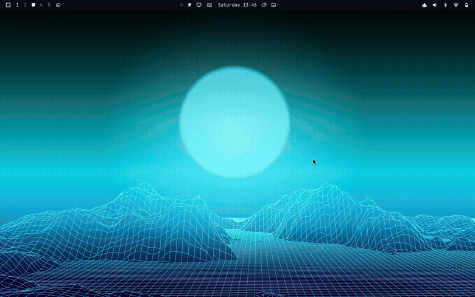
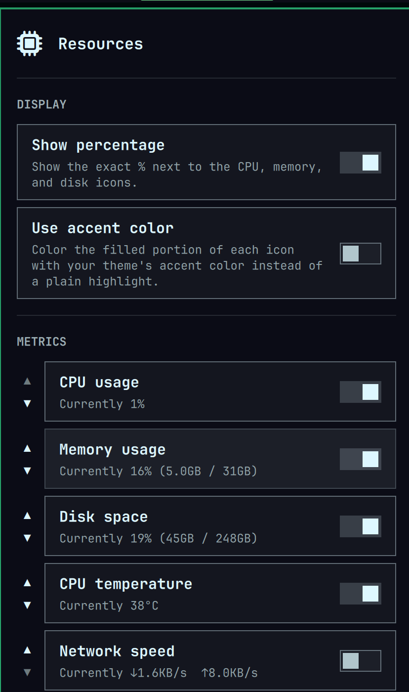

# Resources

A bar widget for [Omarchy](https://omarchy.org/) that shows live CPU, memory,
disk, temperature, and network usage — each as an icon that fills up with
usage, the same way the built-in wifi and battery icons do. Click it for a
settings panel: what to track, in what order, and whether the exact numbers
are shown next to the icons.



## Installation

```bash
omarchy plugin add https://github.com/Kyotroo/omarchy-bar-resources.git
omarchy plugin enable kdm.resources --section right
```

`--enable` on its own only prompts for a section interactively and does
nothing in a non-interactive or scripted install, so the two commands above
are the reliable way to get it onto your bar in one go. Move it later with
`omarchy bar move kdm.resources --section <left|center|right>`, or reorder
what it tracks from its own settings panel — no editing `shell.json` by hand
required.

## What it tracks

| Metric | Source | Notes |
|---|---|---|
| CPU | `/proc/stat` | Delta between two samples, like `top` |
| Memory | `/proc/meminfo` | Uses `MemAvailable`, not `MemFree` — already accounts for reclaimable cache |
| Disk | `df` on `/` | Your root filesystem's used space |
| Temperature | `/sys/class/hwmon` | Auto-detects `coretemp` (Intel), `k10temp`/`zenpower` (AMD) — whichever exists |
| Network | `/proc/net/dev` | Combined throughput across every interface except loopback |

Everything except temperature is read straight from generic Linux kernel
interfaces — no hardware-specific tooling, no `lm_sensors` dependency, works
the same on any distro's kernel. Temperature is the one metric that needs to
know what CPU vendor it's talking to, and does that itself once at startup;
if neither hwmon driver is found (a VM, unusual hardware), it just reports
unavailable instead of guessing.

## Settings panel

Click the widget to open it — no other window behind it, unlike some
"resource monitor" bar widgets that just shell out to `btop`.



- **Reorder** — the ▲▼ buttons on each metric row move it left/right in the
  bar
- **Toggle any metric** on or off independently
- **Show percentage** — hide the numbers, keep just the fill icons
- **Use accent color** — the filled portion uses your theme's accent color
  instead of a plain highlight, so it matches whatever theme you're running
  without any manual color picking
- Each row shows the metric's **current live value** while you decide
  whether to enable it

The bar's own width only changes when you toggle a metric on or off — each
value field reserves space for its worst-case width (`100%`, `999°C`,
`999.9MB/s`), so the numbers ticking over never shifts whatever's sitting
next to it in the bar.

## License

MIT — see [LICENSE](LICENSE).
